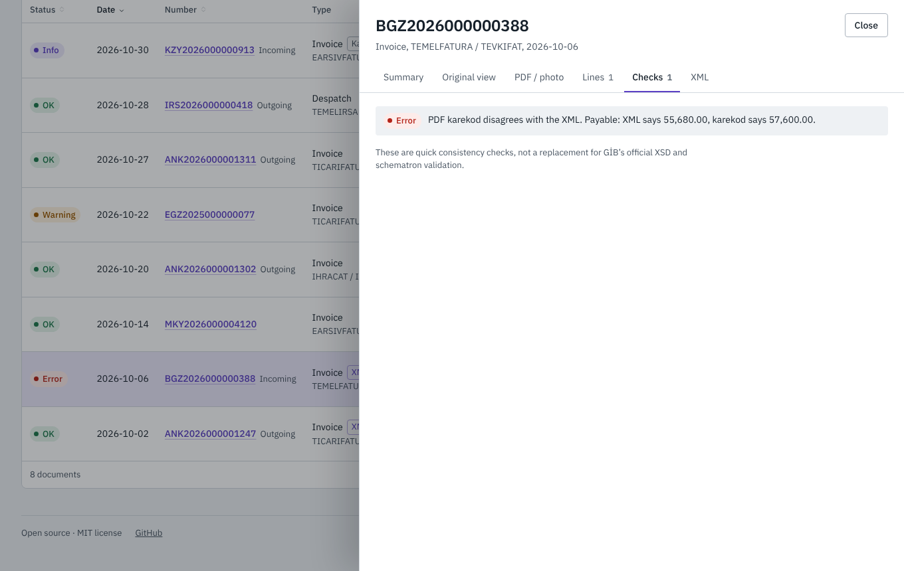
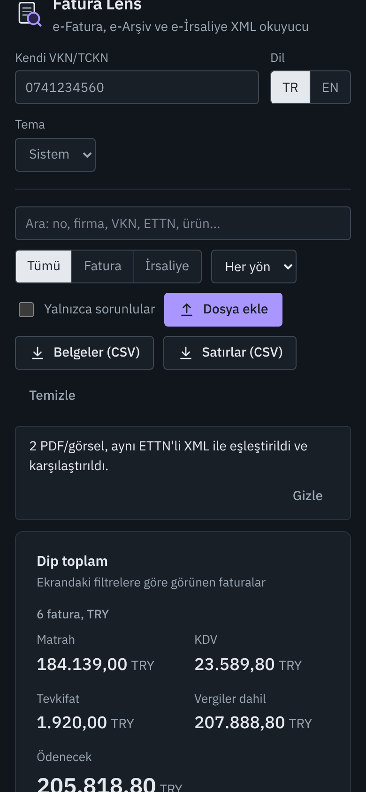
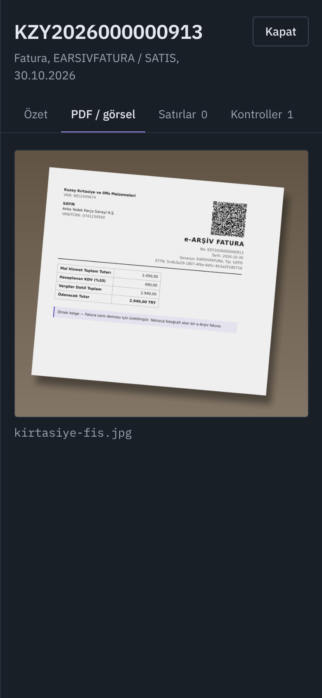

<p align="center">
  
</p>

<h1 align="center">Fatura Lens</h1>

<p align="center">
  <strong>Drop a folder of Turkish e-invoices. Get the totals, the VAT split and every inconsistency in seconds.</strong><br>
  Open-source, offline reader for UBL-TR e-Fatura, e-Arşiv and e-İrsaliye: XML, ZIP, PDF and photos.
</p>

<p align="center">
  <a href="https://harunnkcnn.github.io/fatura-lens/"><b>Live demo</b></a> ·
  <a href="README.tr.md">Türkçe</a> ·
  <a href="#features">Features</a> ·
  <a href="#privacy">Privacy</a> ·
  <a href="#run-it-yourself">Run it yourself</a>
</p>

<p align="center">
  <a href="https://github.com/harunnkcnn/fatura-lens/actions/workflows/ci.yml"></a>
  <a href="LICENSE"></a>
  
</p>

<p align="center">
  <a href="docs/assets/demo.mp4"></a>
</p>

## Why

Every month, accountants, small businesses and logistics teams in Türkiye download ZIP files full of UBL-TR XML from their integrator or the GİB portal, then open them **one by one** to check amounts. Spreadsheets are typed in by hand. Mistakes like a wrong VKN, a line total that doesn't add up or a missing withholding breakdown are found late, if at all.

Fatura Lens reads the whole pile at once, entirely in your browser:

- **No upload, no account, no server.** Invoices contain trade secrets and personal data; they stay on your device.
- **Reads PDFs and photos without OCR.** GİB's karekod standard (2023) requires a QR code on e-Fatura and e-Arşiv PDFs that holds the document's key data as JSON. Fatura Lens decodes it locally, so a PDF from a supplier or a phone photo of a printed invoice becomes a row in the table, with exact numbers instead of OCR guesses.
- **Catches PDFs that lie.** Drop an invoice's XML and its PDF together: they are matched by ETTN and compared. If the PDF your customer saw says a different payable amount than the legally binding XML (a forgotten withholding, a wrong VKN), you see it in red.
- **Survives the end of browser XSLT.** Chrome [stops running XSLT on 17 November 2026](https://developer.chrome.com/docs/web-platform/deprecating-xslt), and Firefox and Safari plan the same. Many web-based e-invoice viewers will silently break. Fatura Lens uses the native engine while it exists and falls back to a bundled WebAssembly build of libxslt, so the invoice's own official layout keeps rendering.

## Features

| | |
|---|---|
| **Batch import** | Drag in any mix of `.xml`, `.zip`, `.pdf`, `.jpg`, `.png` files (nested ZIPs, GİB envelopes and multi-page PDFs included). Re-importing the same files does not double-count. |
| **PDF and photo via karekod** | Reads the GİB karekod from PDFs and photos (rotated or slightly blurry is fine): number, ETTN, parties, VAT by rate, totals. Summary-level by design; the karekod has no line items. |
| **XML ↔ PDF cross-check** | Same ETTN in XML and PDF becomes one row (counted once) and every field is compared: number, date, VKN/TCKN, currency, VAT, tax-inclusive and payable amounts. |
| **Totals that respect currencies** | Net, VAT, withholding, tax-inclusive and payable amounts, per currency. TRY is never added to EUR. Sums use integer kuruş, so 2,000 invoices don't drift. |
| **VAT by rate** | %20 / %10 / %1 / %0 breakdown with base and tax, handy when preparing the monthly VAT return. |
| **Incoming vs outgoing** | Enter your own VKN/TCKN once; every document is labelled and filterable. |
| **Original view** | Renders the stylesheet (XSLT) embedded in each invoice, the same layout the issuer intended. Print-ready. PDFs and photos are shown as they were scanned. |
| **e-İrsaliye** | Despatch advices with plate, trailer plate, driver, carrier and delivered quantities. |
| **Quick checks** | Flags broken ETTN, number/date year mismatch, VKN/TCKN check-digit failures, line totals that don't add up, tax totals vs subtotals, missing withholding on `TEVKIFAT`, duplicate ETTNs with different content. |
| **Excel export** | Documents and line items as CSV, with `;` and decimal commas for Turkish Excel (or `,` and points in English). Formula injection is neutralized. |
| **Search everything** | Number, company, VKN, ETTN, product name, plate, driver. Press `/` to focus search. |
| **Turkish and English** | Full UI in both, light and dark themes, keyboard accessible, works on phones. |

<table>
  <tr>
    <td></td>
    <td></td>
  </tr>
  <tr>
    <td align="center">Totals per currency, VAT by rate, status for every document</td>
    <td align="center">The invoice's own layout, rendered locally and sandboxed</td>
  </tr>
  <tr>
    <td colspan="2"></td>
  </tr>
  <tr>
    <td colspan="2" align="center">XML and PDF matched by ETTN: this PDF forgot to subtract the withholding</td>
  </tr>
</table>

<p align="center">
  
  
</p>

## Privacy

- Files are read with the File API and parsed with the browser's own `DOMParser`. PDFs are rendered with pdf.js and QR codes decoded with ZXing compiled to WebAssembly, both bundled with the app and loaded only when you drop a PDF or image. There is no backend.
- The page ships a strict Content-Security-Policy (`connect-src 'self'`): the app itself cannot send your data anywhere.
- Invoice stylesheets run inside a sandboxed iframe **without scripts** and with their own CSP (`default-src 'none'`), so a hostile XSLT cannot run code, load tracking pixels or reach the network.
- The only things stored in your browser are the language, the theme and the VKN/TCKN you typed. No analytics.

## What the checks are, and aren't

The checks are fast heuristics meant to catch the mistakes people actually make. They have been run against GİB's public UBL-TR example documents (TEMELFATURA, TICARIFATURA, TEVKIFAT, IHRACAT, ISTISNA, YOLCUBERABERFATURA, e-İrsaliye) and tolerate the conventions those use, such as line totals after discounts and VAT reported net of withholding. They are **not** a replacement for GİB's XSD + schematron validation and do not verify digital signatures. If you need full schematron validation, see [efatura-kontrol](https://pypi.org/project/efatura-kontrol/).

## Run it yourself

The live demo is the same static build you get here. Requirements: Node.js 22+.

```bash
git clone https://github.com/harunnkcnn/fatura-lens.git
cd fatura-lens
npm ci
npm run dev        # http://localhost:5173
npm test           # parser, checks, ZIP, CSV and aggregation tests
npm run build      # static files in dist/
```

`dist/` is plain static files. Host it on any web server, an intranet share or GitHub Pages. To serve under a sub-path, build with `VITE_BASE=/your-path/ npm run build`.

## How it works

```
 .xml / .zip ──▶ ingest.ts ─┬─▶ parse.ts ───▶ checks.ts ─┐
                             │   (UBL-TR)                 ├─▶ aggregate.ts ─▶ React UI ─┬─▶ csv.ts
 .pdf / .jpg ──▶ scan.ts ────┴─▶ karekod.ts ──────────────┘   (ETTN pairing,           └─▶ xslt.ts
   (pdf.js, zxing-wasm,          (GİB QR JSON)                 per-currency totals)         (native → WASM)
    loaded on demand)
```

- `src/lib/parse.ts`: namespace-agnostic UBL-TR reader (works with `cbc:`, `n1:` or no prefixes).
- `src/lib/ingest.ts`: ZIP expansion with zip-bomb limits (5,000 entries, 500 MB, 2 levels), BOM and `ISO-8859-9` handling.
- `src/lib/karekod.ts`: reader for the GİB Karekod Standard (v1.2) JSON and the XML ↔ karekod comparison.
- `src/lib/scan.ts`: renders PDF pages and decodes QR codes; its ~1.5 MB of pdf.js and WASM is fetched only when a PDF or image is dropped.
- `src/lib/xslt.ts`: native `XSLTProcessor` when available, [xslt-polyfill](https://github.com/mfreed7/xslt_polyfill) (libxslt compiled to WASM) otherwise, loaded only when needed.
- All sample documents (`src/lib/samples.ts`, `public/samples/`) are synthetic; companies and IDs are fictitious. `scripts/make-samples.mjs` regenerates the PDFs.

## Roadmap

- [ ] Desktop app for Windows and macOS (Tauri), with folder watching
- [ ] Native `.xlsx` export with one sheet per currency
- [ ] Installable PWA for fully offline use
- [ ] e-SMM and e-Müstahsil support (their karekod layouts are already specified)
- [ ] Camera capture on phones for scanning paper invoices directly
- [ ] Monthly VAT return helper (KDV beyannamesi grouping)

Ideas and real-world edge cases are welcome in [issues](https://github.com/harunnkcnn/fatura-lens/issues). Please never attach real invoices; see [CONTRIBUTING](CONTRIBUTING.md).

## License and credits

[MIT](LICENSE) © Harun. Not affiliated with the Revenue Administration (GİB); "e-Fatura", "e-Arşiv" and "e-İrsaliye" are names of public services. Third-party components keep their own licenses; see [THIRD_PARTY_NOTICES](THIRD_PARTY_NOTICES.md).
