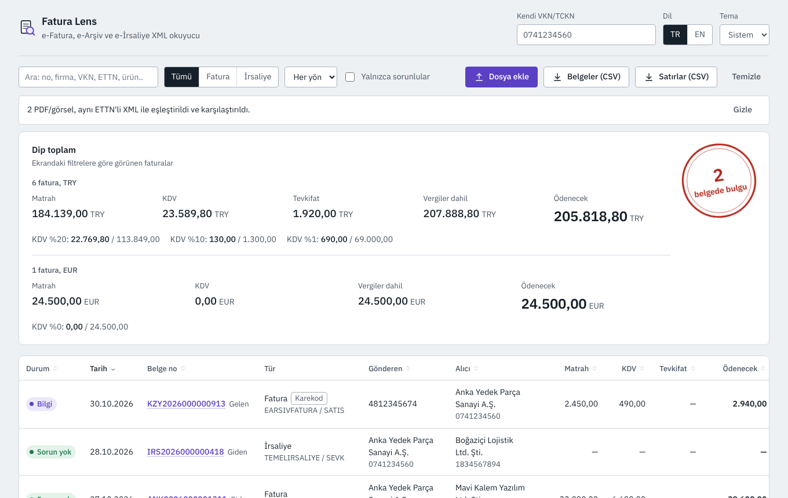
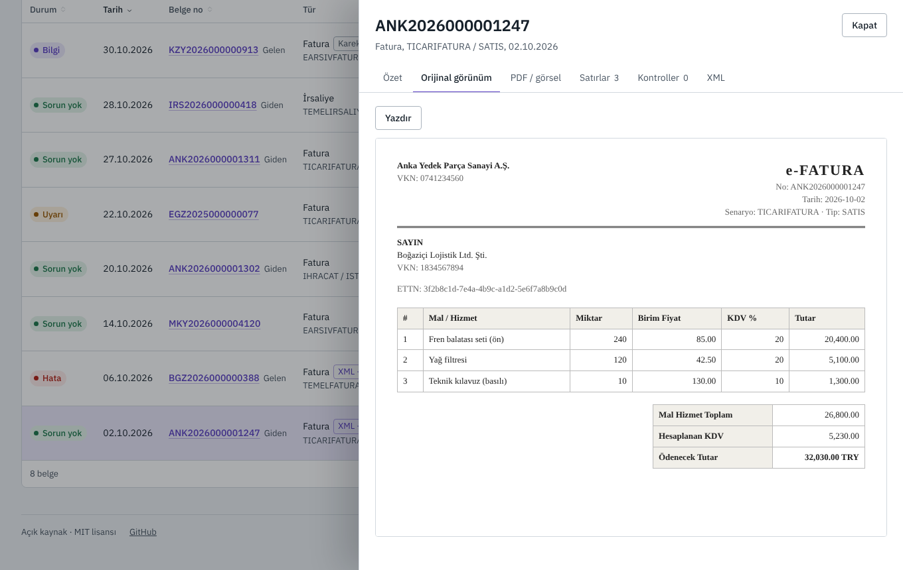
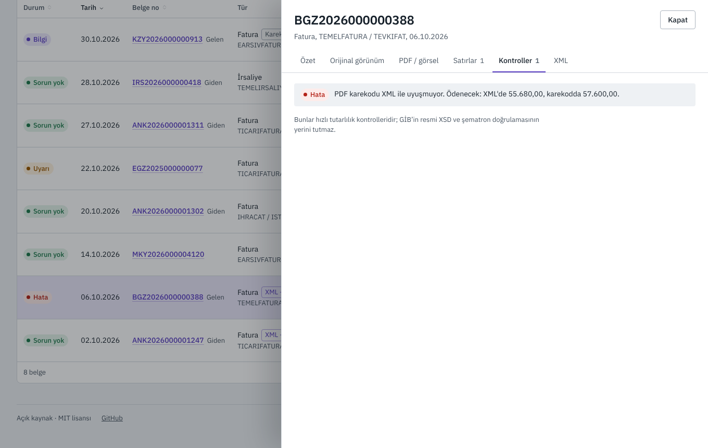
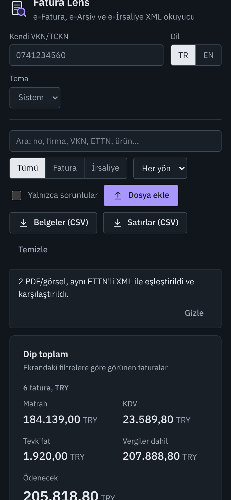
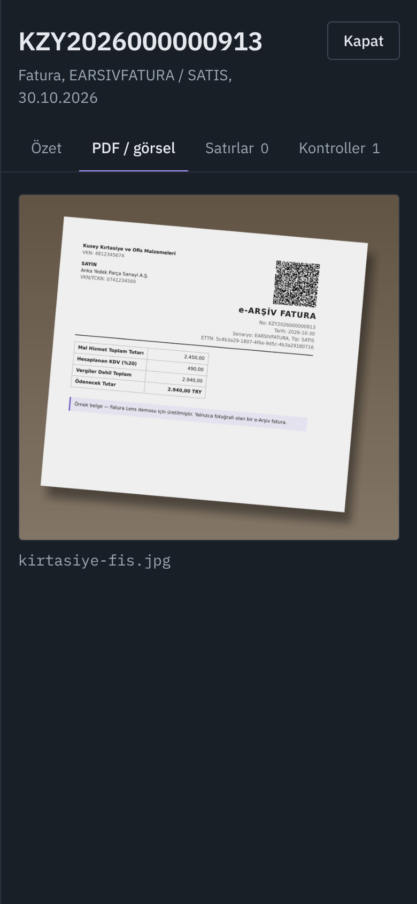

<p align="center">
  
</p>

<h1 align="center">Fatura Lens</h1>

<p align="center">
  <strong>Bir klasör dolusu e-faturayı bırakın. Toplamlar, KDV dağılımı ve tüm tutarsızlıklar saniyeler içinde önünüzde.</strong><br>
  e-Fatura, e-Arşiv ve e-İrsaliye için açık kaynak, çevrim dışı okuyucu: XML, ZIP, PDF ve fotoğraf.
</p>

<p align="center">
  <a href="https://harunnkcnn.github.io/fatura-lens/"><b>Canlı demo</b></a> ·
  <a href="README.md">English</a> ·
  <a href="#özellikler">Özellikler</a> ·
  <a href="#gizlilik">Gizlilik</a> ·
  <a href="#kendiniz-çalıştırın">Kendiniz çalıştırın</a>
</p>

<p align="center">
  <a href="https://github.com/harunnkcnn/fatura-lens/actions/workflows/ci.yml"></a>
  <a href="LICENSE"></a>
  
</p>

<p align="center">
  <a href="docs/assets/demo.mp4"></a>
</p>

## Neden

Her ay muhasebeciler, KOBİ'ler ve lojistik ekipleri entegratörden ya da GİB portalından ZIP dolusu XML indiriyor, sonra tutarları kontrol etmek için **tek tek** açıyor. Excel'e elle yazılıyor. Yanlış VKN, tutmayan satır toplamı, unutulmuş tevkifat kırılımı gibi hatalar geç fark ediliyor ya da hiç fark edilmiyor.

Fatura Lens hepsini birden, tamamen tarayıcınızda okur:

- **Yükleme yok, hesap yok, sunucu yok.** Faturalar ticari sır ve kişisel veri içerir; cihazınızdan çıkmaz.
- **PDF ve fotoğrafı OCR'sız okur.** GİB'in karekod standardı (2023), e-Fatura ve e-Arşiv PDF'lerinde belgenin ana bilgilerini JSON olarak taşıyan bir karekod zorunlu tutuyor. Fatura Lens bu karekodu yerelde çözer; tedarikçiden gelen PDF ya da kâğıt faturanın telefonla çekilmiş fotoğrafı, tahmin değil kesin rakamlarla tabloya girer.
- **Yanlış PDF'i yakalar.** Bir faturanın XML'ini ve PDF'ini birlikte bırakın: ETTN ile eşleşir ve karşılaştırılır. Müşterinin gördüğü PDF'teki ödenecek tutar yasal olarak geçerli XML'den farklıysa (unutulmuş tevkifat, yanlış VKN) kırmızıyla görürsünüz.
- **Tarayıcıların XSLT desteğini bırakmasından etkilenmez.** Chrome [17 Kasım 2026'da XSLT çalıştırmayı durduruyor](https://developer.chrome.com/docs/web-platform/deprecating-xslt); Firefox ve Safari de aynı yolda. Web tabanlı birçok e-fatura görüntüleyici sessizce bozulacak. Fatura Lens yerleşik motor varken onu kullanır, yoksa libxslt'nin WebAssembly derlemesine geçer; faturanın kendi resmi görünümü çalışmaya devam eder.

## Özellikler

| | |
|---|---|
| **Toplu içe aktarma** | `.xml`, `.zip`, `.pdf`, `.jpg`, `.png` dosyalarını karışık sürükleyin (iç içe ZIP, GİB zarfları ve çok sayfalı PDF dahil). Aynı dosyaları tekrar eklemek toplamları ikiye katlamaz. |
| **Karekodla PDF ve fotoğraf** | PDF'ten ve fotoğraftan GİB karekodunu okur (eğik ya da hafif bulanık olabilir): belge no, ETTN, taraflar, oranlara göre KDV, toplamlar. Karekod satır taşımadığı için özet düzeyindedir. |
| **XML ↔ PDF çapraz kontrol** | Aynı ETTN'li XML ve PDF tek satır olur (bir kez sayılır) ve her alan karşılaştırılır: belge no, tarih, VKN/TCKN, para birimi, KDV, vergiler dahil ve ödenecek tutar. |
| **Para birimine saygılı toplamlar** | Matrah, KDV, tevkifat, vergiler dahil ve ödenecek tutar, her para birimi için ayrı. TL asla EUR ile toplanmaz. Hesaplar kuruş cinsinden tam sayıyla yapılır; 2.000 faturada bile kayma olmaz. |
| **Oranlara göre KDV** | %20 / %10 / %1 / %0 kırılımı matrah ve vergisiyle; aylık KDV beyannamesini hazırlarken işinize yarar. |
| **Gelen / giden** | Kendi VKN/TCKN'nizi bir kez girin; her belge etiketlenir ve filtrelenebilir. |
| **Orijinal görünüm** | Her faturanın içine gömülü şablonu (XSLT) işler; düzenleyenin tasarladığı görünüm. Yazdırmaya hazır. PDF ve fotoğraflar tarandığı hâliyle gösterilir. |
| **e-İrsaliye** | Plaka, dorse plakası, şoför, taşıyıcı ve sevk edilen miktarlar. |
| **Hızlı kontroller** | Bozuk ETTN, numara/tarih yıl uyumsuzluğu, VKN/TCKN kontrol hanesi hatası, tutmayan satır toplamı, vergi toplamı ile alt kırılım farkı, `TEVKIFAT` tipinde eksik tevkifat, farklı içerikle tekrar eden ETTN. |
| **Excel'e aktarma** | Belgeler ve satırlar CSV olarak; Türkçe Excel için `;` ayraç ve virgüllü ondalık. Formül enjeksiyonuna karşı korumalı. |
| **Her şeyde arama** | Belge no, firma, VKN, ETTN, ürün adı, plaka, şoför. Aramaya geçmek için `/` tuşu. |
| **Türkçe ve İngilizce** | İki dilde tam arayüz, açık/koyu tema, klavyeyle kullanılabilir, telefonda çalışır. |

<table>
  <tr>
    <td></td>
    <td></td>
  </tr>
  <tr>
    <td align="center">Para birimine göre dip toplam, oranlara göre KDV, her belgenin durumu</td>
    <td align="center">Faturanın kendi görünümü, yerelde ve izole ortamda</td>
  </tr>
  <tr>
    <td colspan="2"></td>
  </tr>
  <tr>
    <td colspan="2" align="center">XML ve PDF ETTN ile eşleşti: bu PDF'te tevkifat düşülmemiş</td>
  </tr>
</table>

<p align="center">
  
  
</p>

## Gizlilik

- Dosyalar File API ile okunur, tarayıcının kendi `DOMParser`'ı ile ayrıştırılır. PDF'ler pdf.js ile işlenir, karekodlar WebAssembly'ye derlenmiş ZXing ile çözülür; ikisi de uygulamayla birlikte gelir ve yalnızca PDF ya da görsel bıraktığınızda yüklenir. Arka uç yoktur.
- Sayfa katı bir Content-Security-Policy ile gelir (`connect-src 'self'`): uygulamanın kendisi verinizi hiçbir yere gönderemez.
- Fatura şablonları **script çalıştıramayan**, kendi CSP'si (`default-src 'none'`) olan izole bir iframe'de işlenir; kötü niyetli bir XSLT kod çalıştıramaz, izleme pikseli yükleyemez, ağa çıkamaz.
- Tarayıcıda yalnızca dil, tema ve girdiğiniz VKN/TCKN saklanır. Analitik yoktur.

## Kontroller ne yapar, ne yapmaz

Kontroller, insanların gerçekten yaptığı hataları yakalamak için hızlı sezgisel denetimlerdir. GİB'in herkese açık UBL-TR örnek belgeleriyle (TEMELFATURA, TICARIFATURA, TEVKIFAT, IHRACAT, ISTISNA, YOLCUBERABERFATURA, e-İrsaliye) denendi ve bunlardaki kullanımları tolere eder; örneğin iskonto sonrası satır toplamları ve tevkifat düşülmüş KDV. GİB'in XSD + şematron doğrulamasının **yerini tutmaz** ve dijital imzayı doğrulamaz. Tam şematron doğrulaması için [efatura-kontrol](https://pypi.org/project/efatura-kontrol/) aracına bakabilirsiniz.

## Kendiniz çalıştırın

Canlı demo, buradaki statik derlemenin aynısıdır. Gereksinim: Node.js 22+.

```bash
git clone https://github.com/harunnkcnn/fatura-lens.git
cd fatura-lens
npm ci
npm run dev        # http://localhost:5173
npm test           # ayrıştırıcı, kontroller, ZIP, CSV ve toplama testleri
npm run build      # statik dosyalar dist/ klasöründe
```

`dist/` düz statik dosyalardır. Herhangi bir web sunucusunda, şirket içi ağda ya da GitHub Pages'te barındırabilirsiniz. Alt dizinde yayınlamak için `VITE_BASE=/yolunuz/ npm run build`.

## Nasıl çalışır

```
 .xml / .zip ──▶ ingest.ts ─┬─▶ parse.ts ───▶ checks.ts ─┐
                             │   (UBL-TR)                 ├─▶ aggregate.ts ─▶ React arayüz ─┬─▶ csv.ts
 .pdf / .jpg ──▶ scan.ts ────┴─▶ karekod.ts ──────────────┘   (ETTN eşleştirme,            └─▶ xslt.ts
   (pdf.js, zxing-wasm,          (GİB karekod JSON)            para birimine göre toplam)      (yerleşik → WASM)
    gerektiğinde yüklenir)
```

- `src/lib/parse.ts`: ad alanından bağımsız UBL-TR okuyucu (`cbc:`, `n1:` ya da öneksiz).
- `src/lib/ingest.ts`: ZIP bombasına karşı sınırlarla açma (5.000 dosya, 500 MB, 2 seviye), BOM ve `ISO-8859-9` desteği.
- `src/lib/karekod.ts`: GİB Karekod Standardı (v1.2) JSON okuyucusu ve XML ↔ karekod karşılaştırması.
- `src/lib/scan.ts`: PDF sayfalarını işler ve karekodları çözer; ~1,5 MB'lık pdf.js ve WASM yalnızca PDF ya da görsel bırakıldığında indirilir.
- `src/lib/xslt.ts`: varsa yerleşik `XSLTProcessor`, yoksa [xslt-polyfill](https://github.com/mfreed7/xslt_polyfill) (WASM'a derlenmiş libxslt); yalnızca gerektiğinde yüklenir.
- Tüm örnek belgeler (`src/lib/samples.ts`, `public/samples/`) kurgusaldır; firmalar ve numaralar gerçek değildir. PDF'ler `scripts/make-samples.mjs` ile yeniden üretilir.

## Yol haritası

- [ ] Windows ve macOS masaüstü uygulaması (Tauri), klasör izleme ile
- [ ] Her para birimi için ayrı sayfalı gerçek `.xlsx` çıktısı
- [ ] Tamamen çevrim dışı kurulabilir PWA
- [ ] e-SMM ve e-Müstahsil desteği (karekod yapıları zaten tanımlı)
- [ ] Telefonda kamerayla doğrudan kâğıt fatura tarama
- [ ] Aylık KDV beyannamesi yardımcısı

Fikirler ve gerçek hayattan uç durumlar [issue](https://github.com/harunnkcnn/fatura-lens/issues) olarak çok değerli. Lütfen asla gerçek fatura eklemeyin; bkz. [CONTRIBUTING](CONTRIBUTING.md).

## Lisans ve teşekkür

[MIT](LICENSE) © Harun. Gelir İdaresi Başkanlığı (GİB) ile bağı yoktur; "e-Fatura", "e-Arşiv" ve "e-İrsaliye" kamu hizmetlerinin adlarıdır. Üçüncü taraf bileşenler kendi lisanslarını korur; bkz. [THIRD_PARTY_NOTICES](THIRD_PARTY_NOTICES.md).
